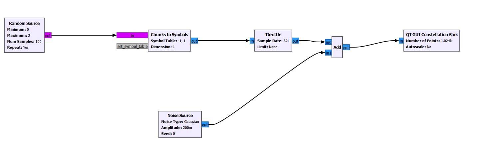
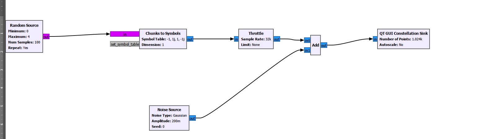
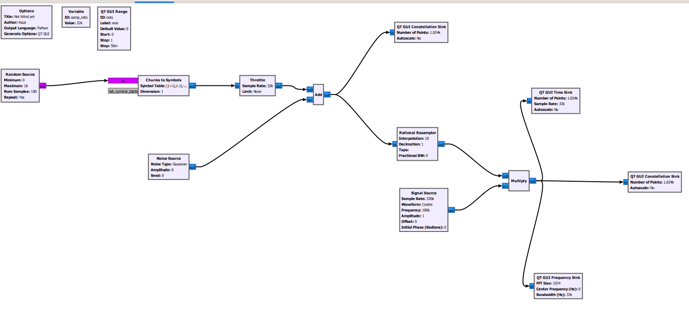
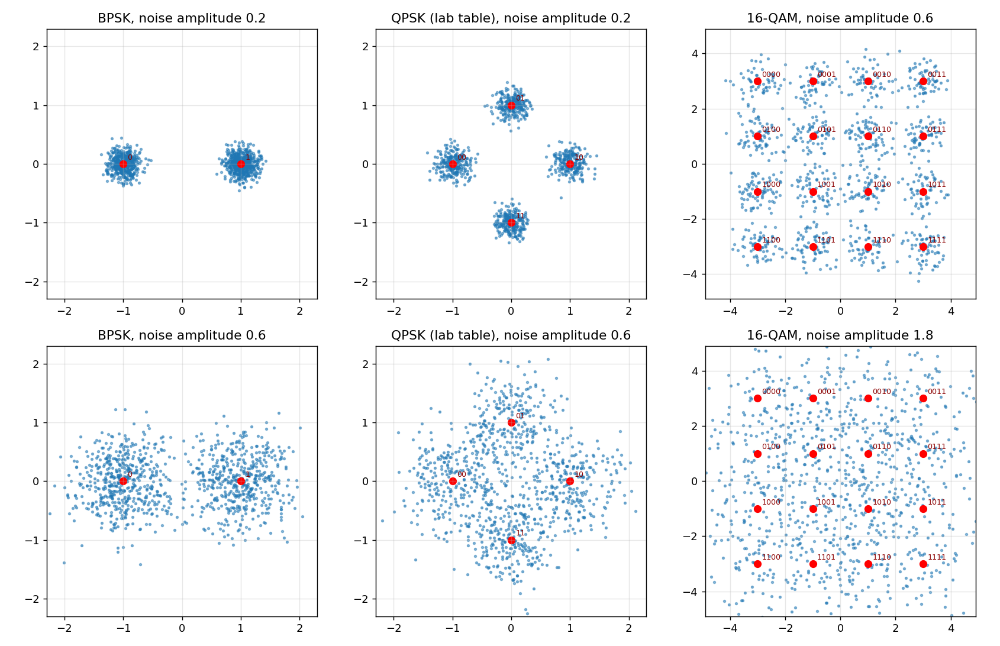
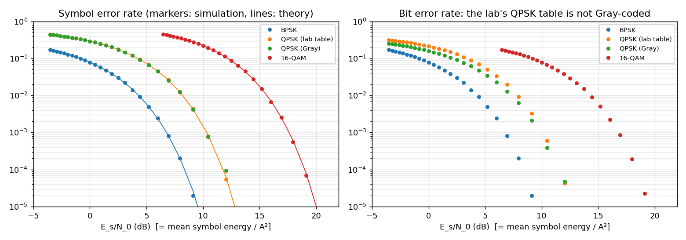
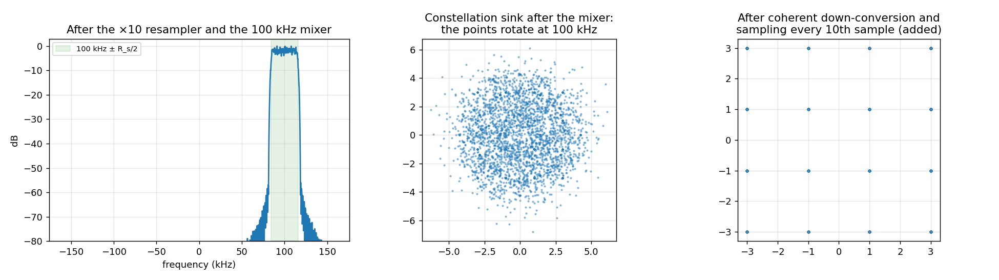

# BPSK, QPSK and 16-QAM in GNU Radio: Constellations, Error Rates and IF Upconversion (Digital Communications Lab, Experiment 4)

This experiment built three **GNU Radio Companion** flowgraphs:
- **BPSK and QPSK:** random symbols → `Chunks to Symbols` → AWGN → constellation display.
- **16-QAM:** the same chain, plus a ×10 resampler and a mixer that moves the signal to a 100 kHz intermediate frequency.

> **Course:** Digital Communications Lab, Amirkabir University of Technology, Spring 2026.
>
> **About this repository.** Only the lab report with flowgraph screenshots ([`flowgraphs/`](flowgraphs)) survived; the `.grc` files did not. [`digital_modulation_grc.py`](digital_modulation_grc.py) **reconstructs the three flowgraphs in NumPy**, block by block, with the parameters from the screenshots. It **extends** them with symbol- and bit-error measurements against theory and with a coherent down-converter.

```bash
pip install numpy scipy matplotlib
python digital_modulation_grc.py       # -> results/*.png
```

| BPSK | QPSK | 16-QAM with IF upconversion |
|---|---|---|
|  |  |  |

## Constellations
The noise model is GNU Radio's complex Gaussian `Noise Source` with amplitude A, which has total power A², i.e. N₀ = A². The lab used A = 0.2:
- for BPSK (E_s = 1) that is E_s/N₀ = 14 dB
- for QPSK (E_s = 1) also 14 dB

The clouds are therefore tight. Raising A spreads every point isotropically until the clouds overlap the decision boundaries. Each point is labelled with its symbol index.



## Error rates vs. theory
The simulation uses 200 000 symbols per point with minimum-distance detection. The symbol error rates match the exact formulas:
- BPSK: $Q(\sqrt{2E_s/N_0})$
- QPSK: $1-(1-Q(\sqrt{E_s/N_0}))^2$
- 16-QAM: $1-(1-\tfrac32 Q(\sqrt{E_s/5N_0}))^2$



**Finding: the lab's QPSK mapping is not Gray-coded.**
- The symbol table `[-1, 1j, 1, -1j]` assigns indices in natural order around the circle. The neighbours of index 0 (`−1`) are index 1 (`j`, one bit different) and index 3 (`−j`, **two** bits different).
- A symbol error therefore costs 1.5 bits on average instead of 1, so the BER is **up to 50 % higher** than with the Gray table `[-1, 1j, -1j, 1]`. The symbol error rate is identical.

## 16-QAM at an intermediate frequency
**Chain:** symbols at 32 kS/s → `Rational Resampler` (×10, windowed-sinc interpolation) → × $e^{j2\pi\,100\text{ kHz}\,t}$ at 320 kS/s.

- **Spectrum.** The signal occupies 100 kHz ± R_s/2 = ±16 kHz. The resampler's interpolation filter suppresses the spectral images by more than 60 dB.
- **What the lab's constellation sink showed.** It sat *after* the mixer, so the points rotate at 100 kHz and the display shows a smeared disc.
- **Added receiver.** A coherent down-converter, sampling every 10th sample, recovers the 16 points, with a worst-case error of 3 × 10⁻³ from the interpolation filter.



## Skills
Digital modulation (BPSK, QPSK, 16-QAM) · Gray mapping · symbol and bit error analysis · interpolation and frequency translation · GNU Radio / SDR · Python and NumPy

## Author
**Sepehr Ebrahimi**, B.Sc. Electrical Engineering, Amirkabir University of Technology (2026)
